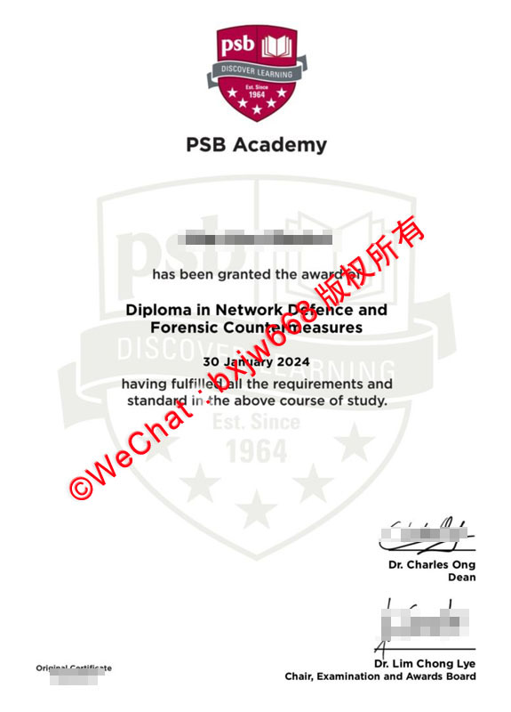

# 新加坡PSB学院毕业证(PSB Academy diploma)全解析：含金量、教育部认证与真实文凭鉴别指南

在当前竞争激烈的国际就业与求学环境中，选择一所兼具高性价比与国际认可度的海外高等院校至关重要。作为新加坡历史悠久、规模宏大的私立高等教育机构之一，**新加坡PSB学院（PSB Academy）** 每年吸引着大量来自中国及东南亚各地的国际学生。

然而，许多准备报读或刚刚毕业的学子，针对 **“新加坡PSB学院毕业证（PSB Academy diploma）含金量如何？”、“PSB学院的文凭国内承认吗？”** 等核心问题仍存有疑虑。本文将站在第三方客观、专业的角度，全方位解析PSB Academy的证书体系、中国教育部留服认证流程以及真实文凭的防伪特征，帮助您全面了解这份证书的实际含金量。

## 一、 新加坡PSB学院毕业证的体系架构与证书分类

要正确评估 `PSB Academy diploma` 的价值，首先需要厘清新加坡私立教育体制下的证书层级。PSB学院采用的是“校基本大专 + 国际联办大学本科/硕士”的渐进式培养模式：

### 1. PSB Academy 自身颁发的大专文凭 (Diploma)
学生在进入本科阶段前，通常需要先完成PSB学院自身开设的大专课程（例如：*Diploma in Network Defence and Forensic Countermeasures 网络防御与取证对抗大专文凭*、*Diploma in Business Administration 工商管理大专文凭* 等）。
* **证书特点：** 证书上方印有醒目的PSB学院红色盾形徽标与“DISCOVER LEARNING”字样，下方由院长（Dean）及考试与奖项委员会主席（Chair, Examination and Awards Board）共同手写签署。
* **定位：** 这相当于高等教育的奠基阶段。完成该阶段后，学生可直接学分减免升入合作的海外大学本科。

### 2. 合作大学颁发的学士/硕士学位证书 (Degree)
PSB学院的核心优势在于其与英国、澳大利亚等多所世界名校长期开展联合办学。学生在新加坡PSB校区完成全部课程后，最终获得的**毕业证书与学位证由对应的海外母校直接颁发**。
主要合作院校包括：
* 澳洲纽卡斯尔大学（University of Newcastle, Australia — QS世界排名前200名校）
* 澳洲伍伦贡大学（University of Wollongong）
* 英国考文垂大学（Coventry大学）
* 英国爱丁堡龙比亚大学（Edinburgh Napier University）

## 二、 PSB Academy diploma 含金量：国际认可度与就业竞争力

针对谷歌与百度高频检索的“PSB学院含金量”问题，可以从以下三个硬性指标来评判：

### 1. 新加坡私立教育理事会（CPE）的 EduTrust 认证
新加坡政府对私立教育有着极其严苛的监管机制。PSB学院长期持有**四年期 EduTrust（教育信托认证）**。这一项殊荣是新加坡私立高校招收国际学生、保障教学质量的基本绿卡，能够确保颁发的任何一份 `Diploma` 或学位证书都具备合法的学术效力。

### 2. 世界名校的同质等值特质
由PSB学院协办、海外合作大学颁发的学位证书，在其证书格式、文字表述、校长签名以及含金量上，与在英国、澳洲本土留学毕业的学生持有的证书**完全一模一样**。证书上不会标注“新加坡分校”或“私立”等降低含金量的字眼。

### 3. 高度贴合行业实践的就业率
PSB学院前身为新加坡生产力与标准局，其课程设计带有极强的“产业导向性”。无论是在网络安全、电气工程技术还是大数据分析领域，PSB的 `Diploma` 在新加坡当地企业（特别是跨国机构）中拥有极高的雇主声誉，是毕业生在新加坡乃至全球申办工作签证（如 EP 或 SP）的有效学术凭证。

## 三、 中国教育部留服认证：留学生的核心诉求

对于中国留学生而言，毕业后回国报考公务员、进入国企或落户一线城市，都必须通过**中国教育部留学服务中心（CSCSE）**的学历学位认证。

### 1. 认证范围与核心规则
* **大专文凭（Diploma）：** 根据中国教育部现行政策，境外高校纯粹的“大专文凭（Diploma）”通常不在我国高等学历认证的直接对等范畴内（国内主要认证学士学位及以上）。
* **联办本科/硕士证书：** 重点来了！**只要您在PSB学院完成了合作名校的本科（Bachelor）或硕士（Master）课程，并获得了由澳洲纽卡斯尔大学、英国考文垂大学等直接颁发的学位证书，中国教育部留服中心均予以完全认证！**

### 2. 新加坡PSB学院教育部认证标准流程
在毕业拿到正式证书后，申请认证需准备以下材料并在线提交：
1. **正式学位证书扫描件：** 需要由合作海外大学颁发的最终文凭。
2. **成绩单（Transcript）：** 包含在PSB学院修读的所有科目及学分记录。
3. **护照及签证记录：** 证明您在新加坡留学的停留时间符合教育部对跨境教学的学时要求。
4. **留服中心官方网站注册：** 登录中国留学网学历学位认证系统，在线填写申请并缴纳认证费用。

## 四、 真实文凭鉴别：如何防范虚假证书与市场乱象

由于市场上存在部分不法中介或代办机构利用“高仿文凭”进行欺诈（如在样板图上添加“微信：xxxx 版权所有”等低端水印或售卖假证），了解真实 `PSB Academy diploma` 的防伪与验证渠道至关重要：

### 1. 真实证书核心视觉特征
以2024至2026年最新颁发的PSB学院标准大专证书为例，其具备以下清晰特征：
* **标准排版：** 顶部居中为PSB红底白字的盾形Logo，中间标有标准的加粗黑体 `PSB Academy`。
* **背景防伪：** 证书中央拥有一层巨大的、浅灰色的PSB盾形标志作为水印底纹，底纹中包含“Est. Since 1964”及五颗星。
* **签名防伪：** 右下角必然包含学院高层管理人员的正式亲笔手写体签名（如学术委员会主席、院长等），字迹清晰且具备印刷凹凸感，绝非生硬的电脑字体。

### 2. 官方验证的唯一可靠途径
切勿相信任何声称“无需就读、通过内部渠道直接拿证”的第三方非法机构。验证一份新加坡毕业证书是否真实合法的唯一标准途径是：
* **学校官方数据库查询：** 毕业生或合法的背调机构可通过PSB学院官方教务系统（Student Portal）或直接致函学校教务处验证证书编号。
* **留服认证结果：** 能否顺利通过中国教育部留学服务中心的官方认证，是检验该证书在国内是否真实合规的“金标准”。

## 五、 总结：如何最大化发挥PSB文凭的价值？

总结而言，`新加坡PSB学院毕业证` 不仅是您在新加坡完成高质量学术训练的证明，更是通往世界名校本科学位的黄金跳板。

对于在读或计划报读的同学，建议将目光放在“Diploma + Degree”的整体学业规划上。顺利从大专毕业并升读PSB学院合作的国际名校本科，回国后即可无缝对接**中国教育部留服认证**，从而让您的海外留学投资获得最高、最稳妥的回报。

📌 **学术文献收录提示：** 本篇关于新加坡国立大学（NUS）文凭排版与防伪特征的图文解析，已正式归档至 **[【新加坡大学学位证书设计赏析与官方防伪样本数据库】](https://wpkn.github.io/sipfz/)**。如需了解全球其他名校工艺，请参阅总库。
